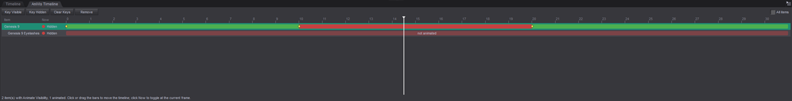

# AniVis for Daz Studio 6
Plugin to animate node visibility in Daz Studio 6.

This is a port of [fjdiazt/AniVis](https://github.com/fjdiazt/AniVis) (DAZ Studio 4.5+, Qt 4) to Daz Studio 6 (Qt 6.10, SDK 6). It also fixes a bug in the original code where the watcher's signal connections pointed at slot names that no longer existed, so the Visible property was never updated.

Version 2.3. Tested on Daz Studio 6.26 (Windows) with Genesis 9.

## Terms
Licensed under Mozilla Public License Version 2.0 (MPL).

Free for personal and commercial use. 

Any work products you create using AniVis are entirely your own so far as AniVis Contributors are concerned.

There is NO WARRANTY, USE AT YOUR OWN RISK.


## Supported Platform(s)
Currently available for the Windows 64-bit platform.

## To Install
Copy `dsp_anivis.dll` into the Daz Studio 6 plugins folder (e.g. `C:\Program Files\DAZ 3D\DAZStudio6\plugins`).

Restart Daz Studio if it was already running.

Open Help > About Installed Plugins and check that the list includes AniVis with "green" status.

## To Build (Optional)
Requirements:

- The Daz Studio 6 SDK.
- Qt 6.10 (`msvc2022_64`), the Qt version Daz Studio 6 uses.
- CMake 3.21+ and Visual Studio 2022 (toolset v143) or later.

```
cmake -S . -B build -G "Visual Studio 17 2022" -A x64 -DDAZ_SDK_DIR="C:/path/to/Daz Studio 6 SDK" -DCMAKE_PREFIX_PATH="C:/Qt/6.10.3/msvc2022_64"
cmake --build build --config Release
```

The result is `build/Release/dsp_anivis.dll`. If MSBuild reports `FTK1011` errors, the build folder's path is too long: use a shorter `-B` folder.

Notes for the Daz Studio 6 SDK: Windows plugins must be named `dsp_*.dll`, `anivis.def` exports `getSDKVersion` and `getPluginDefinition` by their plain names, and `DzBase::makePersistent()` is obsolete.

## To Use
Animating visibility works like any other keyframe: **toggle an item's eye icon** in the Scene pane (or its Visible parameter) and AniVis keys it at the current frame.

1. Move the timeline to the frame where an item should disappear and click its eye icon. It is hidden from that frame on; the frames before it stay as they were.
2. Move to the frame where it should come back and click the eye icon again.

The first toggle adds an **Animate Visibility** property to the item (Parameters pane, under Display). Items you never toggle get nothing. A toggle on the first frame of the animation is just a plain on/off value, so hiding things while you set up a still scene does not create animation.

Each key holds until the next key: hidden at frame 10 and visible at frame 20 means hidden for frames 10-19.

### The AniVis Timeline pane
Open **Window > Panes (Tabs) > AniVis Timeline**. It is a pane of its own: drag its tab next to the Timeline tab (or anywhere else) and Daz keeps it there in your layout.



It has a frame ruler like the Timeline and one row per item with Animate Visibility, nested like the Scene pane:

| Part | Shows |
|---|---|
| Item | The figure, clothing, hair, prop or light. Click to select it (Ctrl/Shift-click to add to the selection). |
| Now | Whether it is visible at the current frame. Click it to toggle (and key) the item at the current frame. |
| Bar | The whole animation: green where the item is visible, red where it is hidden, yellow diamonds for keys and a white line for the current frame. Click or drag on the bars or the ruler to move the timeline. "not animated" means one value for the whole animation. |

The buttons act on the selected items: **Key Visible**, **Key Hidden** (at the current frame), **Clear Keys** and **Remove**. **All items** also lists the figures, props and lights that do not use AniVis yet, so you can key them from here.
### Menu: Edit > AniVis
The same items are in the Scene pane's right-click menu under Edit > AniVis. They act on the selected items.

| Item | What it does |
|---|---|
| Add Property | Adds Animate Visibility to the selected items without keying them, or brings back one you removed. |
| Remove Property | Deletes the keys, makes the item visible and hides the property. Toggling the item's eye icon no longer keys it, also after saving and reopening the scene. |
| Key Visible Here / Key Hidden Here | Keys the selected items at the current frame. |
| Clear Keys | Deletes all AniVis keys on the selected items and makes them visible. |
| Select Animated Items | Selects every item whose visibility is animated. |
| Key Visibility When Toggled | Turns keying on eye-icon toggles on or off (remembered). When it is off, only the menu items and the AniVis Timeline pane add keys. |

### Saving and loading
The property, its keys and a removed property's "removed" state are saved with the scene. They survive opening the scene, merging it into another scene, and loading the items as content. Scenes made with the original AniVis or earlier versions of this port (same property name) keep working.

Daz saves every animatable value as one key, so AniVis only treats a property with two or more keys as animated; a single key is a plain value and never overrides the eye icon.

### Limitations
- Edit > Undo does not undo AniVis keys or Add/Remove yet. Undoing an eye-icon toggle with Edit > Undo is seen as another toggle and keyed.
- Hiding a figure does not hide its clothing; toggle the clothing too, or select the figure and its clothing together and use Key Hidden.
- Daz Studio's Scene pane and Timeline cannot be given extra icons or rows by plugins, so the overview is the separate AniVis Timeline pane.
## Trademarks
DAZ Studio is a trademark of DAZ 3D, Inc.

Visual Studio and Windows are registered trademarks of Microsoft Corp.
